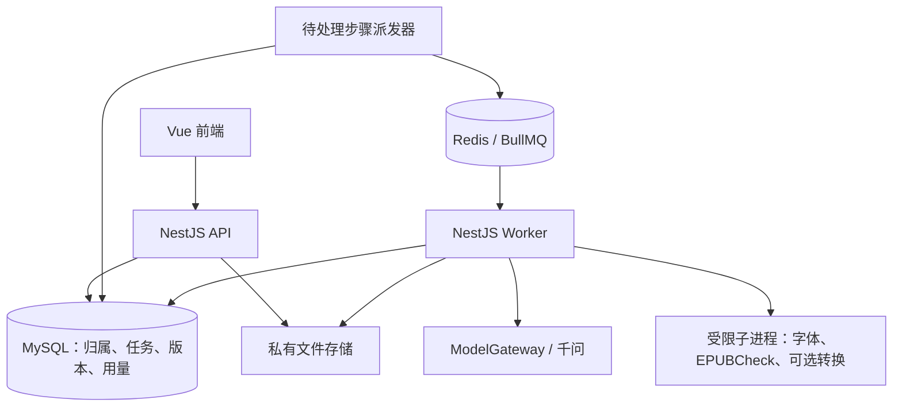

# EPUB AI 后端架构设计

日期：2026-10-20。状态：用户已确认本版作为后端架构基线，后续按阶段落地；已开始第一条业务链实现，当前进展与尚未实现项见 [业务实现说明](processing-phase-a.md)。本设计文档包含未来目标，不能全部视为现有能力。按首版少量用户、单机运行、以后可增加 Worker 的目标设计。文中的限制与并发是待压测的起始建议，不代表现有服务器配置或已测吞吐。

2026-10-21 新增[章节插画工作流讨论稿](chapter-illustration-workflow.md)：独立讨论章节概要、插入锚点、构思、生图、图片资产和插入校验，尚未实现或确认为架构基线。

## 1. 主要决定与当前基础

采用 **NestJS 模块化单体，同一仓库提供 API 与 Worker 两个运行入口**。继续使用 MySQL、Prisma、Redis、BullMQ；私有文件通过存储适配器管理。AI 输出受约束的结构判断，确定性排版引擎修改文件，校验通过后才发布产物。

优先建立的扩展边界是：文档输入格式、语义分析、主题与设备规则、输出格式、模型供应商、文件存储。它们的版本与产物分别保存，切换主题可以复用结构分析，换模型也不需要重写 API 或排版引擎。

设计时的代码审查快照（实现前）：

| 位置                                   | 现有能力                                         | 设计需要补齐                                               |
| -------------------------------------- | ------------------------------------------------ | ---------------------------------------------------------- |
| `src/ai/ai.service.ts`                 | 千问兼容接口、请求上限、超时、输入校验；默认关闭 | 领域输出校验、能力配置、错误分类、用量账本、预算和结果复用 |
| `src/queue/queue.service.ts`           | BullMQ producer，默认单次尝试                    | Worker、步骤检查点、持久幂等、取消、恢复和资源限制         |
| `src/queue/redis.service.ts`           | API 使用的有限重连连接                           | Worker 独立的持久连接配置                                  |
| `prisma/schema.prisma`                 | `BackgroundJob` 的 id/type/status/时间           | 文件归属、输入输出、配置版本、步骤、模型调用和预算         |
| `Dockerfile`、`compose.production.yml` | API 镜像，根只读，API `/tmp` 32 MB               | Worker 专用镜像与临时磁盘；外部工具不放入 API 镜像         |
| 当前本地样书脚本                       | 单本第一章 4 小节，内容检查有效                  | 通用路径发现、资源图、逐章处理、参数化规则和兼容性测试集   |

样书脚本写死了 OPF 路径、章节文件、旧 CSS 引用和正文数量，并把整个 ZIP 读进内存；它只适合作为参考实现与回归样本。当前后端没有上传、排版、下载业务，也未安装 LangChain。第一版可以沿用内部模型适配器；未来采用 LangChain 时，将其放在该适配器内部。

## 2. 运行拓扑与模块



API 只处理归属、上传、参数、任务创建与查询，不在 HTTP 请求生命周期内解析整本书或等待模型。Worker 可使用 Nest standalone context 复用依赖注入；其内部入口必须自行校验任务负载和归属，不能依赖 HTTP pipe/guard。[Nest 官方独立应用说明](https://docs.nestjs.com/standalone-applications)

建议目录按业务组织，避免每个 service 再包一层空接口：

```text
src/
  main.ts                         # HTTP 入口（现有）
  main-worker.ts                  # 拟新增：无公网监听的 Worker 入口
  uploads/                        # 接收、校验、完成上传、过期处理
  books/                          # 原书、归属、分析版本和资源引用
  processing/                     # 任务、阶段、派发、租约、恢复、取消
  documents/epub/                 # 导入器、资源图、章节与来源定位
  layout/                         # 角色、版本化主题、设备规则、计划执行
  validation/                     # 内容、资源、导航、格式检查
  artifacts/                      # 存储、预览、导出与下载授权
  ai/                             # 模型适配、计划校验、限流、用量与预算
  common/                         # 沿用已有配置、日志、HTTP 协议
```

需要明确接口的变化点：`ArtifactStorage`、`ModelProvider`、`DocumentImporter`、`Exporter`。初期每种只实现所需版本，使用显式注册表；主题以版本化配置包发布，不允许运行时安装任意脚本插件。

## 3. 核心数据契约：原书、结构分析、渲染结果分开

### 3.1 原书与内部资源图

原书在保存期内不可变，每次修复或排版生成新产物。按 EPUB 容器声明找到 OPF，读取 manifest、spine、EPUB 2 NCX 或 EPUB 3 nav；不假定目录名、文件扩展名或章节路径。原始资源是保真依据，内部模型只增加索引与语义覆盖层。[W3C EPUB 3.3](https://www.w3.org/TR/epub-33/)

`DocumentSnapshotV1` 至少包含 source SHA256、解析器版本、格式、layoutMode、语言、资源引用、阅读顺序、目录、按文档保存的块索引和内容完整性基线。每块 ID 绑定原文档路径、位置、内容摘要及解析版本；原书未变、解析版本相同才能复用。保留内联图片、链接、ruby、代码、表格等原节点及来源，不能先压平成纯文本再生成一本书。

首版范围：无 DRM、可重排、常见横排中文文字 EPUB。固定版式、漫画、扫描书、竖排及复杂公式先检测并报告能力边界。`encryption.xml` 也可能描述标准字体混淆，需识别算法，不能只凭该文件存在就认定整书 DRM；不支持的字体混淆首版保留原资源或明确拒绝相关操作。

### 3.2 结构分析与排版配置

`StructurePlanV1` 只描述原块的角色和来源依据，例如章标题、节标题、正文、引文、短行、注释、列表、图注，以及未确定项。先使用原标签、目录与重复样式规则，疑难片段附邻近上下文交给 AI；模型自报 confidence 只作辅助记录。

`RenderSpecV1` 单独描述 themeId/version、targetProfile/version、字体策略、导出格式和规则包版本。相同结构分析可以生成多种主题与 EPUB/AZW3，不因换字体或主题重新调用模型。

```json
{
  "schemaVersion": "structure-plan/v1",
  "sourceHash": "sha256:...",
  "snapshotVersion": "epub-parser/v1",
  "roles": [{ "blockId": "doc04:block12", "role": "poem" }],
  "unresolvedBlockIds": []
}
```

这只是形状示意。执行前校验 sourceHash、完整块覆盖、ID 存在性与唯一性、角色枚举、结构冲突、锚点有效性、数量上限及 schema 版本。AI 不返回可执行代码、任意路径、完整正文或任意 CSS。截断、拒绝、缺块和冲突输出不会成为成功计划；允许保持原样并记录未处理项。

### 3.3 执行与变更记录

首版以 CSS 调整为主。需要添加角色标记或改结构时，进入明确的结构变更路径：只执行登记过的操作，每项绑定原始来源并生成变更记录。章、节的真实层级由语义决定，不用视觉字号替代层级。

主题负责视觉参数，设备规则负责可接受的输出约束；规则冲突由执行器解决。当前已验证的 reader-first 配方可成为第一个规则包，仍需扩大样书测试。不得机械删除所有原 CSS：先识别受处理正文范围，保留特殊内容与未知样式，再应用经过验证的角色映射。

## 4. 业务流水线与任务状态

```text
完成上传并核实对象 → 输入检查 → 逐章解析 → 规则分类
→ 可选 AI 分类 → 计划校验 → 代表性预览 → 完整渲染
→ 内容与 EPUB 格式检查 → 发布下载产物
```

逻辑上区分 `analyze` 与 `export` 两类任务。分析成功保留结构版本，导出引用该版本与 RenderSpec；前端可以自动串联默认分析和导出，不增加必须确认一次才能继续的产品流程。预览先生成代表性章首、连续正文和一种特殊段落，前端按章节加载。预览可用不代表整书导出已成功。

任务状态只保留 `QUEUED → RUNNING → SUCCEEDED / FAILED / CANCELLED`，具体工作存 `stage` 与 `completedUnits/totalUnits`。`cancelRequestedAt` 独立保存，Worker 停止并完成收尾后才写取消终态。显示真实的阶段和已处理章节数；首版轮询查询即可，后续可添加 SSE，断线后仍以数据库快照恢复。

每阶段持久化输入指纹、配置指纹、尝试、结果引用和状态。阶段建议为 `inspect / parse / classify / validate-plan / preview / render / validate-output / publish`；AI 多片段调用各有记录，避免为每个普通段落创建队列任务。

### 幂等、恢复与派发

- 创建任务使用 `unique(ownerId, operation, idempotencyKey)`；同时保存请求体摘要，相同 key 携带不同参数返回冲突。
- 第一版把数据库中的待派发步骤作为可靠清单：短事务提交任务与首步骤，派发器补投 Redis。后续每次都将“完成当前步骤、提交检查点、创建下一待派发步骤”放进同一短事务；最后一步同时提交业务终态，避免步骤完成后进程崩溃使流水线丢失后续工作。
- 每个步骤另存 dispatchGeneration。队列负载仅 `{runId, stepId, dispatchGeneration, payloadVersion}`，jobId 使用 `s-{stepId}-d{generation}`；同代补投复用 ID，经过数据库重试决策后递增代数并生成新 ID。不能一直使用 stepId 当 jobId，否则仍保留的 failed 记录可能阻止新尝试。消费者核对数据库当前代数，旧代消息直接跳过。队列故障时返回已记录的排队状态，不能宣称已经开始处理。
- Worker 用数据库条件更新领取步骤并递增 leaseVersion；续租、检查点提交和发布都携带该版本。旧 Worker 不能覆盖新执行者的结果。
- 步骤已有通过校验的输出时直接复用；源文件、计划或工具版本改变则产生新步骤/任务，不修改历史成功记录。
- 输出先写不可变 attempt 对象并核实 hash，再由持有当前租约的短事务发布 Artifact 引用。存储写入与 SQL 不具有共同事务，定时回收无引用对象。
- 取消、删除和发布竞争时，在同一短事务中检查 cancelRequestedAt、leaseVersion、任务状态及 Book/Asset 是否仍可用、未进入删除，确定唯一终态。过期清理先获取相同业务记录的锁并标记删除；旧 Worker 不能发布已删除书籍的新产物。
- 启动和定时恢复检查待派发、过期租约、未完成阶段和孤立产物。遇到已发送但结果未知的付费调用，走调用账本决策，不随整阶段重放。

BullMQ 需要按可能重复投递设计；CPU 阻塞会影响锁续约。现有 `attempts:1` 不能保证一次执行。jobId 可以减少重复，持久幂等仍依赖数据库，因为队列记录会清理。[幂等任务](https://docs.bullmq.io/patterns/idempotent-jobs)、[Stalled jobs](https://docs.bullmq.io/guide/workers/stalled-jobs)、[Job IDs](https://docs.bullmq.io/guide/jobs/job-ids)

第一版无需独立事件总线；待需要订单、邮件、webhook 等与业务事务一致的多种事件，再引入明确的 Outbox 表和派发机制。所有 ZIP、AI 和外部工具操作都在数据库事务之外。

## 5. 数据与存储

以下是逻辑实体，不是本次执行的 Prisma 迁移。实现时评审字段和索引，并与 SQL 迁移一起提交。

| 实体              | 主要职责与约束                                                                                                    |
| ----------------- | ----------------------------------------------------------------------------------------------------------------- |
| `Book`            | ownerId、原始 Asset、sourceHash、检测结果、保留期；不覆盖原文件                                                   |
| `Asset`           | 随机 storageKey、kind、SHA256、字节数、状态、过期时间；状态区分上传中、待验证、可用、删除中                       |
| `ProcessingRun`   | bookId、operation、状态、阶段、幂等 key 与请求摘要、冻结的配置版本、取消/错误/时间                                |
| `RunStep`         | runId、stepKey、输入/配置指纹、状态、attempt、dispatchGeneration、leaseVersion/leaseUntil、结果引用；步骤唯一约束 |
| `AnalysisVersion` | sourceHash、snapshot 引用、结构计划引用、模型/提示/schema/规则版本、质量摘要；版本不可变                          |
| `Artifact`        | runId、类型、RenderSpec、对象引用、内容与格式检查摘要、是否可发布、过期时间                                       |
| `ModelCall`       | 逻辑调用指纹、attemptNo、模型与能力快照、状态、供应商 requestId、finishReason、usage、预占/估算金额               |
| `BudgetBucket`    | scope（单任务/owner/系统）、周期、额度、已预占、已结算估算；事务或条件更新防穿透                                  |

ownerId 从受控身份边界取得，不接受客户端任填。开发可用固定本地测试主体，公开试用前必须落实归属校验与可计量额度；账号提供商可单独替换，无需先自建完整密码系统。用户付费点数与供应商成本分开建账；商业收费实施时再增加正式用户收费账本。

MySQL 保存可查询元数据、状态、索引与小摘要。原 EPUB、章节索引、计划正文、预览、导出、较大报告存私有文件；Redis 只放队列与有界短期协调数据。段落 AST 不逐段建数据库行，文件内容不塞进队列。

建议索引：任务 `(ownerId, createdAt, id)` 游标分页；恢复 `(status, updatedAt)`；步骤 `(status, leaseUntil)`；清理 `(status, expiresAt)`；调用逻辑指纹与 attempt 唯一。数据库连接总数按 API 副本、Worker 副本及每进程池大小一起计算。

### 存储适配与上传完成语义

- 开发使用专用目录；单机首版可以使用专用持久数据卷，API 流式上传/下载并计算 hash。存储接口使用流与 storageKey，防止业务依赖本机绝对路径。
- 多主机 Worker 或上传带宽成为瓶颈时，切到私有对象存储与客户端直传。对象完成后由服务端校验大小、摘要与格式，再标可用，不能只相信客户端完成通知。
- 每次上传使用新的随机 key。预签名链接本质是有时限的访问能力，可能在到期前重复使用；已有 key 上传还可能被覆盖。完成后应复制到不再开放写入的正式 key 或绑定不可变 version，并核实内容身份。[S3 官方预签名链接说明](https://docs.aws.amazon.com/AmazonS3/latest/userguide/using-presigned-url.html)
- 数据库保存对象 key/version，不保存永久公开下载 URL；下载时校验归属并签发短期链接或后端流式传输。
- 私有缓存默认 owner 范围。相同书 hash 也不跨用户暴露存在性或复用不属于其授权范围的书籍结果。
- 保留期是可配置产品策略：起始可考虑任务临时文件结束后清理、失败残留 24 小时、导出 7 天、原书/分析 14 天，正式上线前与用户可见说明一致。这些是建议值，不是现有行为。
- 清理先写删除标记并停止新任务，再取消/等待活动引用、按依赖删除文件和缓存、保留最少无正文用量记录；支持清理重试和备份保留期说明。单机也要验证 MySQL 备份、文件备份及恢复流程。

## 6. AI 能力与成本控制

### 调用边界

`ModelGateway.classifyBlocks()` 接收编号块、必要上下文和规则版本，返回领域结构数据。`QwenProvider` 封装当前 HTTP 调用；能力配置包含 provider、region、明确模型版本、结构化输出支持、输入/输出上限和超时。既有通用 AiService 可作为底层，不向前端提供任意模型代理。

千问 JSON Object 只保证 JSON 格式；JSON Schema 的支持依模型而异。无论供应商保证哪种格式，后端都执行领域语义校验与完整性校验。处理 finishReason、输出截断、拒绝和缺失 usage，不能只取 choices[0].content 就认为成功。[千问结构化输出](https://help.aliyun.com/zh/model-studio/qwen-structured-output)

书籍中的文字是待分析数据，不能指挥模型调用工具、改变预算或读取文件。首版模型没有文件、网络、shell 或数据库工具权限。

### 预算、用量与重试

1. 调用前在短事务中原子检查并预占单任务、owner 周期和系统周期预算，锁按固定顺序取得；每次重试和升级模型都重新预占。限制输入大小、输出上限及最多调用次数。
2. Token 使用对应 tokenizer（可用时）和保守余量估算；中文字数不等于 token。预占不假设缓存命中。货币使用定点微单位或 Decimal，价格按模型、地域、上下文阶梯与价格版本冻结。
3. 每次调用独立记录 `RESERVED → DISPATCHED → SUCCEEDED / FAILED_CONFIRMED / UNKNOWN`。在发送前落账，无法确认是否发出或是否完成时按 UNKNOWN 保守处理；未可靠收到 usage 不记作零费用。
4. 超时和用户取消可能发生在供应商已执行之后。应用幂等只保证一次结果被采用，无法据此承诺上游只推理或只计费一次。未知调用保留额度、等待有限时间对账/补收；确需重试时新建 attempt 并预占，不让任务恢复偷偷重发。
5. 明确鉴权、参数、订购/账单/预算错误不自动重试；可恢复故障采用有限退避和 jitter。429 也需按业务错误码分类；统一管理 SDK 与 Worker 重试，防止次数相乘。人工/用户重试同样受预算约束。
6. 按 provider/model/region 的全局并发、RPM、输入输出 TPM 限流；每个 owner 另有限额和公平调度。Redis 限流不可用时暂停新模型派发，不能绕过限流继续发请求。
7. `reserved`、按 usage 的 `settledEstimated`、供应商对账后的费用区分记录。预算估算存在误差，供应商预算开关也可能延迟，不能宣称人民币绝对硬上限；额外使用明确请求次数、token 上限与运营总额熔断。

模型逻辑调用与 attempt 有持久唯一约束。领取调用、创建预占和发送前标记均检查当前步骤租约；一旦进入 DISPATCHED，就不能因队列重投而复用同一 attempt 再发送。用量结算或释放预占时，将 ModelCall 状态条件更新与全部 BudgetBucket 调整放在同一事务，重复响应/恢复只结算一次；原始响应对象已落存储而 SQL 未提交时，由恢复器验证对象后补齐该事务。UNKNOWN 只能由明确的对账或预算策略转移，普通超时清理不会自动释放为零费用。

依据：[千问限流](https://help.aliyun.com/zh/model-studio/rate-limit)、[错误码](https://help.aliyun.com/zh/model-studio/error-code)。上述应用账本与恢复策略是本项目设计，不是供应商的幂等承诺。

估算公式（按实际供应商规则补充阶梯/缓存写入等费用；推理 token 已计入输出 usage 时不再重复累计）：

```text
模型估算成本 = Σ(未缓存输入 token × 输入单价
               + 命中缓存 token × 缓存单价
               + 输出/计费推理 token × 对应单价)
单位任务成本 = 模型估算 + 转换计算 + 存储占用 + 下载流量
```

第一版先积累真实 usage，按书籍结构与处理模式统计成本分布，再决定用户按本、额度包或订阅定价。避免未经测量宣称“每本几分钱”。

### 结果复用与后续模型演进

| 层级     | 指纹必须包含                                                                          | 换主题时                 |
| -------- | ------------------------------------------------------------------------------------- | ------------------------ |
| 解析     | ownerScope、sourceHash、parser/IRVersion                                              | 复用                     |
| 结构计划 | 解析指纹、片段与上下文摘要、规则/提示/schema/路由版本、模型明确版本、生成参数         | 角色计划不含主题时复用   |
| 字体子集 | ownerScope、字体源 hash/字重、完整字符集 hash、fontTools 与配置版本                   | 字体及应用范围相同时复用 |
| 导出     | sourceHash、计划 hash、theme/deviceProfile/fontPolicy、输出格式、执行器/工具/校验版本 | 重新渲染，复用上游       |

只缓存通过校验的完整结果，首次并发命中使用数据库唯一约束与租约合并。模型别名 latest 无法解析出快照时，缩短缓存有效期并记录实际返回模型，不承诺长期可重现；正式基准优先使用可固定的版本。

模型路由先用显式规则：普通分类用经济模型，复杂/冲突片段在次数与预算内升级一次。模型升级经授权样书回归再逐步放量，比较准确性、未确定比例、每本调用量、成本和耗时。供应商前缀缓存后续根据实际命中接入；异步 Batch 更适合离线回归与非即时批量场景，需核对模型、地域、计费和缓存互斥规则。[上下文缓存](https://help.aliyun.com/zh/model-studio/context-cache)、[批量推理](https://help.aliyun.com/zh/model-studio/batch-inference/)

## 7. 性能与资源管理

### 首版工作方式

- 上传流式落盘/对象存储并计算 hash；ZIP 按 entry 读取与复制，XHTML 逐章解析释放，图片默认保字节不解码、不重压缩。
- 队列首版沿用 `epub-processing`，按阶段执行；计算密集工具用受控独立子进程。AZW3 启用时增加转换队列，避免转换占住普通排版容量。
- 单 Worker 同时处理一本计算密集任务作为保守起点，AI HTTP 小批次并发另限；扩大并发前实测 RSS、CPU、临时盘与供应商配额。
- API 与 Worker 各有连接和健康状态。API Redis producer 快速失败；Worker 用独立持久连接，手动复用 ioredis 时按要求设置 `maxRetriesPerRequest:null`。队列 Redis 使用 `noeviction`，计划缓存主要在私有存储与 MySQL 元数据中，不能让大缓存挤掉队列数据。[BullMQ 连接规则](https://docs.bullmq.io/guide/connections)
- Node 事件循环不承担同步整书压缩/大 XML 工作；fontTools、EPUBCheck、Calibre 的版本和参数固定。CPU 隔离能避免阻塞锁续约，但 BullMQ sandboxed processor 本身不是完整的文件/网络安全沙箱。[并发](https://docs.bullmq.io/guide/workers/concurrency)、[独立处理器](https://docs.bullmq.io/guide/workers/sandboxed-processors)

候选输入限制（实现与压测后再冻结）：上传 100 MiB、总实际展开 512 MiB、10,000 entries、单 XHTML 16 MiB、单 entry 64 MiB。另设总节点数、单章块数、运行时间和临时磁盘配额；实际流中再次计数，ZIP 声明仅作预检。遇到超限返回可解释结果，不自动抬高限制。当前下载目录含约 52 MB 技术书，必须用真实大文件测量，不能只测约 1 MB 小说。

Worker scratch 使用专用有配额磁盘，避免把整书与字体工具全部装进 API 的 32 MB tmpfs；临时盘需求按原包、展开包、中间产物和输出同时存在的峰值计算。单任务唯一目录、非 root、限制总 RSS/CPU/PID/时长，工具进程禁网络；超时终止整个子进程树，成功、失败与取消都收尾。JVM heap 上限不能代替进程/容器总内存上限。

### 背压与公平性

排队容量、每 owner 活跃任务数和待处理展开字节都设上限。共享首版可以限制每 owner 1 个活跃书籍任务，超出进入有界等待；限制值是配置而非产品承诺。磁盘不足、数据库/Redis 不可用或模型额度不足时停止接新执行，返回明确等待/失败原因；已上传文件有过期清理。

每台机器最大重任务数先按以下式子估算，再由实测降低：

```text
并发上限 ≤ min(可供 Worker 的内存 / 单任务 P95 峰值内存,
                CPU 计算容量, 临时盘容量, 外部工具与模型配额)
```

P95 不能覆盖异常大任务，仍需单任务硬资源限制与余量。切换主题、重试纯导出、仅预览时不重复解析/调用 AI；AZW3 和字体嵌入按需求生成。

## 8. 保真、格式与预览

完整性校验分级：

| 路径              | 必须验证                                                                                          |
| ----------------- | ------------------------------------------------------------------------------------------------- |
| CSS-only          | 所有 body 原始字节、原图片字节、spine/导航与资源引用，变更范围仅允许的样式/包声明                 |
| 角色标记/结构调整 | 精确文本节点与内容顺序、inline 图片位置、链接/脚注往返、ruby、代码/诗歌空白，允许变更逐项登记     |
| EPUB→AZW3         | 定义转换允许的结构/缩略图变化，重新提取并按内容角色验证；不能把删除全部空白后的相等当通用保真依据 |
| 字体增强          | 全应用范围字符覆盖、字重、许可和嵌入引用，阅读器可回退                                            |

原书检查先形成基线，输出检查区分原有问题与新增问题；新增阻断问题不得发布“成功”产物。修复操作版本化、留记录，只实施已测规则。EPUBCheck 用于格式符合性，文本保真和视觉效果另行验证。[EPUBCheck 官方文档](https://www.w3.org/publishing/epubcheck/docs/)

字体目录保存源 hash、版本、许可文本、嵌入/子集/改名要求。整本书按实际应用的完整字符集裁剪并核对 cmap/必要排版表；当前 1,700 字符子集仅适合现有四节，不能当作通用中文字库。Worker 预装经过核准的静态字体，任务不临时联网取字体。[fontTools subset](https://fonttools.readthedocs.io/en/latest/subset/)

预览提供经过处理的私有资源，通过隔离 origin 与 sandbox iframe 展示；移除脚本/事件，阻止远程资源、外部实体和网络 DTD。预览资源净化另存副本，原书与导出内容修改规则分开；预览若有差异需标记。初期使用浏览器渲染导出样式，不增加每书启动服务端浏览器截图的计算开销。

不执行 EPUB 内脚本，不把文件文本当模型指令，不将完整正文写入普通日志。ZIP 入口拒绝路径逃逸、绝对路径、符号链接、重复/规范化冲突条目；外部工具也只能访问本任务文件。

格式报告、浏览器渲染、Kindle Previewer、Send to Kindle 和 USB 实机分别记录。服务器导出成功只代表对应层通过，不承诺所有设备像素一致。Kindle 字体与阅读器设置规则参见 [官方文字规范](https://kdp.amazon.com/en_US/help/topic/GH4DRT75GWWAGBTU)。当前样本尚未完成实机与云端投递验证。

## 9. API 草案与前端契约

沿用 `/api`、全局 `{data, meta.requestId}` / `{error, meta.requestId}` 和 DTO 校验。大文件走 multipart 流或对象直传，不能提高全局 JSON 限制来塞 base64 EPUB。以下是拟新增契约，当前均未提供。

| 方法与路径                           | 职责                                                                     |
| ------------------------------------ | ------------------------------------------------------------------------ |
| `POST /api/v1/uploads`               | 创建归属内上传；本地实现可同接口接 multipart，对象存储实现可返回上传能力 |
| `POST /api/v1/uploads/:id/complete`  | 核实最终对象、hash、大小和可接受性；幂等完成                             |
| `POST /api/v1/books/:id/analyses`    | 创建分析任务，接收幂等 key，202 返回 runId 与查询地址                    |
| `GET /api/v1/runs/:id`               | 查询持久状态、真实阶段、完成单位、预算摘要、可用预览/产物 ID             |
| `POST /api/v1/runs/:id/cancel`       | 请求取消；明确不承诺退回已执行模型费用                                   |
| `POST /api/v1/books/:id/exports`     | 引用 analysisVersion 和 RenderSpec，创建幂等导出任务                     |
| `GET /api/v1/artifacts/:id/download` | 归属校验后下载或短期重定向，不返回内部文件路径                           |
| `GET /api/v1/artifacts/:id/preview`  | 获取受控预览资源清单与实际校验范围                                       |

`complete` 成功时生成/关联 Book，前端只传公开 ID 与允许的主题参数。模型名称、模板正文、预算规则和存储路径由服务器决定。接口版本、计划 schema 版本和算法版本分别管理；普通字段追加不要求升级整个 API。

## 10. 部署演进、观测与验收

### 分阶段交付

| 阶段            | 必要交付与验收                                                                                                                         |
| --------------- | -------------------------------------------------------------------------------------------------------------------------------------- |
| A：确定性闭环   | 上传/归属、私有存储、API/Worker、任务状态/幂等/恢复、通用 EPUB 导入、首个规则包、内容/格式校验、预览与 EPUB 导出；默认 AI 关闭也可工作 |
| B：受控 AI      | 结构计划 schema、Qwen 适配、调用账本、预算与全局限流、未知调用处理、计划复用；模拟供应商测试后再用授权样书实测                         |
| C：阅读器与字体 | 全书字体子集、可选 AZW3、不同结构样书回归、明确型号/固件/路径的实测报告                                                                |
| D：按证据扩展   | 多主机存储、增加 Worker、副本限流、更多主题/格式、模型升级灰度，依据瓶颈逐项进行                                                       |

首个生产形态可以在同一台已核实资源的服务器上运行 API、Worker、MySQL、Redis、反向代理与私有卷；给数据库与 API 留出独立资源余量。共享服务器目前配置、已有服务、端口和权限尚未核实，本设计不等于已确认可部署。现有部署文档与 Compose 的本地修改继续保留，实际部署前另行核实。

扩展触发与改造：

| 观测到的变化                         | 改造方向                                                             |
| ------------------------------------ | -------------------------------------------------------------------- |
| 排队长，重任务 CPU/RSS 高，API 正常  | 增加 Worker 容量；字体/转换拆独立队列与镜像                          |
| 多台 Worker 或上传/下载拖慢 API      | 切私有对象存储、直传和短期下载能力                                   |
| 模型限流或等待主导耗时               | 调整全局 RPM/TPM/并发、请求切片、缓存与模型路由；加机器不一定有效    |
| API 本身成为瓶颈                     | 横向扩 API，更新全局限流、代理信任配置与总连接预算                   |
| 用户需要手动纠正、主题切换与历史对比 | 在 AnalysisVersion 上加独立人工覆盖版本，保留原分析和出处            |
| Kobo/Apple Books/更多 Kindle 路径    | 增加 targetProfile/Exporter 与实测矩阵，复用导入和结构分析           |
| PDF、扫描件、漫画、复杂教辅          | 独立导入器与能力契约；OCR/读序/分页成本单独预算，重新定义保真验收    |
| 自然语言描述风格、封面生成           | 将偏好映射到允许的主题参数；生成封面作为独立可选产物，单独预算与校验 |
| 摘要、翻译、内容改写                 | 独立内容变更任务与版本，重新定义文本质量验收，不沿用原文不变的承诺   |
| 多日等待、人工回执与跨业务补偿很多   | 再评估持久工作流引擎与 Outbox 扩展                                   |

首版无需引入 Kubernetes、微服务拆分、向量数据库、通用 Agent 循环或完整插件市场。可扩展性来自稳定的数据契约、版本、资源边界和可恢复步骤。

观测至少包含：每阶段 P50/P95 耗时、排队等待、RSS 峰值、临时磁盘、输入/展开字节、失败类型、重试/stalled、每本调用次数/usage/估算成本/未知费用、计划与导出缓存命中、未确定角色数、内容/格式检查结果。指标不使用原书名或全文作为标签；日志仅记录 runId、stepId、requestId 和安全事件码。

验收测试优先覆盖真实风险：双击同请求只创建一个业务任务；DB 已提交/Redis 失败可补投；杀 Worker 后从步骤恢复；旧租约不能发布；付费超时记 UNKNOWN 且不悄悄重发；并发预占不超卖额度；取消与发布一致；更换主题不增加结构分析调用；大文件和巨型单章不拖垮 API；格式错误与正文差异不能发布成功。

回归书籍分层使用授权小说、缺少语义标签的书、短行/脚注/插图、英文空格、代码/表格、大图与大文件。书籍不入公开仓库，CI 使用自建小型合法样本。Worker/模型/解析器/字体/主题版本升级先回归，再逐步放量。具体吞吐、等待时间与单本成本需完成这些测量后给出。
