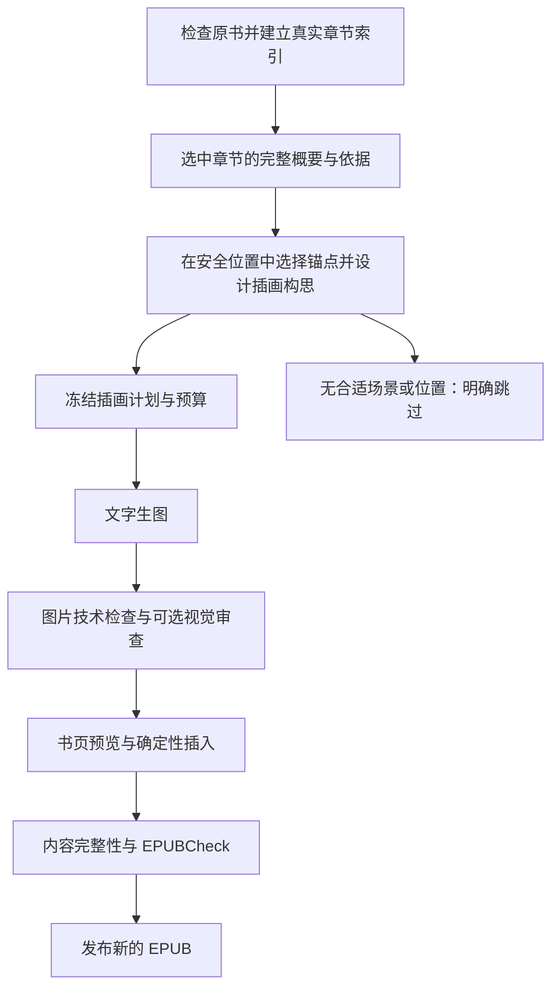

# 章节插画工作流设计

日期：2026-10-21。状态：讨论稿，基于当前真实代码审查；尚未实现，未调用文字或图片模型。本文扩展[后端架构基线](backend-architecture.md)，不改变当前纯排版业务与默认关闭的外部服务。

## 1. 建议的业务链

用户提出的“提取概要 → 寻找插入位置 → 生成图 → 插入”可以作为产品主线。内部增加来源索引、插画构思与结果校验，把每一步的输出保存成可复用的版本。



概要回答“发生了什么、哪些事实来自哪里”；构思回答“这一幅想表达什么、哪些内容省略、主次和空间如何安排”。不能把概要直接转成一串待绘制的物件。首期一次文字规划调用可合并概要、场景选择、构图候选和位置建议，不要求一个逻辑步骤对应一次收费调用。

首期设计范围限定为一个高置信度章节、一张章末图，先验证实际阅读效果。服务端强制 `chapterIds.length === 1`、`maxImages === 1`、`placement === 'chapter-end'`，且章节覆盖必须为 `COMPLETE`；`PARTIAL` 或位置不确定时不能准入生图。系统应允许 `SKIPPED`，不要求每章必须有图。后续再增加章中图、多章批量和全书角色一致性。

## 2. 代码现状与需要先补齐的能力

| 当前代码                                                                      | 已有能力或约束                                            | 插画扩展                                                            |
| ----------------------------------------------------------------------------- | --------------------------------------------------------- | ------------------------------------------------------------------- |
| `processing/processing-worker.service.ts`、`processing.repository.ts`         | 独立 Worker、持久阶段、派发代数、租约版本、取消、原子发布 | 复用调度规则；章节/图片子项单独存储                                 |
| `processing.types.ts`                                                         | 每 Run 最多 16 个唯一阶段；checkpoint 有界                | 顶层保持少量阶段，不为每章增加一个 stage；正文和图片不进入 Run JSON |
| `ProcessingRun.modelCall`、`reserveModelCall()`                               | 每 Run 一个付费调用记录，第二个不同请求会冲突             | 拆出按调用持久化的账本，支持文本和图片计价                          |
| `documents/epub-structure.ts`                                                 | 32 个有界短段落候选，用于结构角色分类                     | 新增完整章节索引和有界的长章分段分析，不能复用旧采样作章节概要      |
| `documents/epub-engine.ts`、`epub.types.ts`、`business/processing-handler.ts` | 要求全部 body 源码一致，报告固定声明保留                  | 新建插画输出协议，验证只增加获准插入内容                            |
| `layout/reader-first.ts`                                                      | AI 角色样式按 `nth-child` 定位                            | 依据最终插入位置重映射源段落索引                                    |
| 私有存储、引用检查、EPUBCheck                                                 | 可复用的产物与格式验证                                    | 加入图片资产、最终 XHTML 引用和插入补丁验证                         |

采用 NestJS 模块内的确定性工作流与已有 Worker。当前无需引入自由调用工具的 Agent 或新的流程平台。以后使用 LangChain 时，将结构化模型调用放在适配器中；状态、预算、文件修改与发布仍由业务代码决定。

## 3. 来源索引与章节概要

### 建立 `ChapterIndexV1`

程序从 OPF、spine、NCX/nav 和正文标题综合建立逻辑章节。一个章节可以跨多个 XHTML，一个 XHTML 也可能含多个章节范围。当前报告的 `chapters = spine.length` 是文档计数，不能用于实际章节选择或按章计费。

索引记录原书 hash、解析器版本、阅读顺序、章节对应的文档范围、内容块 ID、内容 hash、结构置信度和安全插入候选。标题与目录冲突时标为未确认，首期跳过相关章节，不能按文件名猜测。

### 生成 `ChapterAnalysisV1`

仅分析用户选择的章节。短章在明确的输入限额内一次读取；长章按完整段落分块，分别摘要后汇总，保留块的覆盖清单、原文 ID 和去重规则。任何上限导致的遗漏都必须记录为 `PARTIAL`，不能称已读完整章节；超出总预算时停止或让用户缩小范围，不静默截取前几段。

概要至少保存：事件顺序、重要人物及有依据的外观、场景事实、情绪解读、关键关系、可画场景及依据块 ID。将事实、解读、艺术安排分别表示。首期不把“两个阵亡者”推断成“两个哀悼者”之类的数量关系交给自由改写。

章节摘要及原文摘录存在私有存储中，元数据只保存引用与 hash。书内文字视为待分析数据，不能成为模型工具指令。文字模型仅接收本次必要内容，图片模型仅接收经过约束的场景描述；不向图片接口上传整本书或完整章节。

## 4. 插入位置与插画构思共同规划

### 位置由程序枚举，模型选择 ID

候选仅为确定能插入的完整块边界。首期优先章末，避开脚注、列表、表格、诗歌连续组和标题与首段之间。不存在安全位置时跳过。

私有锚点记录包含：

```ts
interface InsertionAnchorV1 {
  id: string;
  sourceSha256: string;
  parserVersion: string;
  chapterId: string;
  documentId: string;
  blockId: string;
  contentSha256: string;
  boundary: 'after';
  readingOrder: number;
  sourceRange: { start: number; end: number; unit: 'utf16-code-units' };
}
```

当前 XML 解析位置是 JavaScript 字符串下标，不能按 UTF-8 字节偏移直接切文件。插入器使用相同已校验源码/编码和解析版本，重新验证锚点及源 hash。模型只看候选 ID 及必要上下文，不返回文件路径、XPath、字符位置、HTML 或 CSS；失效锚点报错，不能自动挪到相似段落。

### 插画计划 `IllustrationPlanV1`

计划包含章节概要引用、锚点 ID、事实依据、读者到该处已知的内容、构思候选、选中构思、全书风格版本、图片规格、生成模式和替代文本草稿。

可以用一次文本调用提出 2–3 个表达角度不同的文字构思，自动选择默认方案并保留理由；不默认花钱生成三张图。用户可以覆盖选择，不要求在流水线每一步确认。风格配置规定形状处理、色彩、线条、细节密度、人物约定与留白，章节方案在约束内变化。

章中图必须使用插入点之前的事实制作 brief。服务端检查所有事实依据的最大阅读顺序不晚于该位置，并限制传给构思/生图的上下文；位置检查只能排除已知越界，不能保证模型完全没有暗示性剧透。首期章末图可降低这个问题。

模型自报信心和情绪分数不作为质量证明。全书风格仅凭少量章节时须标记为暂定。默认 `generationMode: 'text-to-image'`，不传上一张图；只有用户明确要求参考图或改图时，使用单独的版本及模式。

位置引用与视觉 brief 分开计算指纹。更改插入位置但视觉事实、尺寸和剧透条件均未改变时，可以复用原图；改变构思或画面内容才产生新的生成版本。

## 5. 生图接口、资产与质量

`IllustrationProvider` 隔离供应商协议，能力表记录支持的同步/异步模式、尺寸、计价单位、幂等键、任务查询及参考图能力。当前对话内置的生图工具不是可直接由 NestJS 调用的生产 API；接入后端必须选择真实服务和独立配置。已保存的第三方千问文字凭据不代表可以调用官方阿里云图片接口。

```ts
interface IllustrationProvider {
  submit(
    input: FrozenImageRequest,
  ): Promise<
    | { kind: 'complete'; result: ProviderResult }
    | { kind: 'accepted'; providerJobId: string }
  >;
  query?(providerJobId: string): Promise<ProviderTaskState>;
}
```

请求参数由服务器白名单编译，固定首期一张图、无内嵌标题/正文、无任意外部参考地址。记录模型、地区、参数、prompt 版本、输入指纹及价格版本；seed 仅在服务支持时记录，不承诺可重复得到相同像素。

首期若接异步服务，就必须扩展 `RunStep` 的 `WAITING + nextPollAt`，并把 `StepHandler` 返回值分为 `complete` 与 `wait`。供应商任务 ID、调用记录、等待检查点和等待状态在同一受 leaseVersion 保护的短事务中提交；释放租约后，派发器只在到期时以新派发代数唤醒查询同一个任务，等待不是成功，不能走当前无条件 `completeStep()` 的路径。崩溃导致响应未持久化仍属于结果未知，不能假定尚未提交。这样无需先实现批量 `ProcessingUnit`，也不持有数据库事务或 Worker 租约等待数分钟。同步接口使用独立超时与资源配额，不能照搬当前文字请求的 30 秒。

获取结果后先下载到私有资产，不把临时供应商 URL 写入 EPUB。仅接受服务端供应商适配器产生的地址，对重定向、协议、目标地址和响应体积进行校验；禁止由模型提供任意下载 URL。限制真实解码的格式、像素数、文件体积与内存，生成受控 PNG/JPEG 导出副本并保存 hash。供应商原始文件及导出副本分开引用。

质量分两层：

- **技术门**：图片可解码、尺寸/体积合规、已落盘、hash 可核验、包内引用有效。失败资产不可插入。
- **表达审查**：事实关系、主要元素、构图主次、与书页的协调。可选视觉模型辅助给出问题，但其评分不能代表美感已经合格。alt 根据最终画面复核，不能一直沿用生成前猜测。

产品应提供可选预览，允许换图、跳过和移动。人工审查不作为所有任务的必经等待点；需要用户选择时，以已完成的计划/图片为版本，后续导出创建新 Run，Worker 不等待人。自动模式也受图片数量与预算上限限制，不能以“审美未通过”为由无限重画。

## 6. 确定性插入与新完整性协议

新增输出协议 `illustrated-epub-v1`，始终从不可变原书与冻结的排版/插画计划构建副本，禁止在上次输出上继续叠加，防止重复插图。

首期在原 XHTML 中追加注册模板：EPUB 2 使用兼容的 `div + img`，EPUB 3 可使用 `figure + img`。资源名称、相对路径与 OPF manifest 均由代码创建，转义 alt/可选 caption。图片在包内；CSS 使用可重排尺寸，避免固定屏幕高度，不烘焙文字。首期不新增 spine 文档，因此可继续严格保留 spine、NCX/nav 和原有 ID。媒体登记遵循 [EPUB 资源规范](https://www.w3.org/TR/epub-33/#sec-publication-resources)；替代文本与实际可访问性仍须独立审查，不能凭通过格式检查声明符合全部 [EPUB Accessibility](https://www.w3.org/TR/epub-a11y-11/) 要求。

插图会改变 body，不能继续报告 `bodyBytesPreserved: true`。采用版本化验证：

1. 插入计划只允许通过锚点验证的零长度新增补丁，不允许替换或删除原文。
2. 独立校验器从源 body 和计划中的确切插入片段重建 `expectedBody`，与成品 body 完整比较；不因节点带某个标记就忽略任意修改。
3. 所有原文片段、原节点顺序、原资源及内联关系保持；未插图文档继续要求 body 字节一致。
4. 插入前后差异必须完全属于登记的 body 插入、head/CSS、manifest 与新资源白名单；已有修复仍单独记录。
5. 当前角色 CSS 使用 `body > p:nth-child(n)`；组装器必须按插入计划重算每个源段落的最终索引，再独立检查角色与源块映射，不能沿用旧选择器。
6. 对最终 XHTML 重新解析 ID 与 references，将新增图片/CSS 纳入 manifestPaths，写包后再次核验实际资源 hash 和引用。

报告 v2 明示 `bodyBytesPreserved: false`（存在插图的书），并报告 `originalTextPreserved`、`originalMarkupSlicesPreserved`、`originalResourcesPreserved`、`allowedInsertionsVerified`、插画数量/位置/计划与资产 hash。保留旧纯排版报告语义，不直接放宽旧模式。

EPUBCheck 前后比较继续作为发布门，新插入内容不得产生新增错误。既有源书问题单独列出，源无错误时输出也应无错误。格式与内容检查通过不等于视觉优秀；浏览器预览也不等于 Apple Books、Kindle 或 Send to Kindle 已验证。

## 7. 任务、持久化与恢复

顶层 Run 建议使用 `inspect → analyze → plan → generate → review → render → validate → publish` 八个粗阶段。首期仅一个章节，后续阶段内部可派发独立、有限数量的章节/图片单元；不能把无限子项写入当前 Run JSON。

最小持久化扩展：

| 对象                           | 保存内容                                                    | 复用规则                              |
| ------------------------------ | ----------------------------------------------------------- | ------------------------------------- |
| `IllustrationOperation`        | owner/source、串联 Run 的共同预算作用域、总额和累计调用金额 | 子 Run 沿用同一作用域，不重置预算     |
| `BookAnalysisRevision`         | 原书/解析版本、章节覆盖、私有概要/依据索引引用              | 同 owner、同源和分析输入版本可复用    |
| `IllustrationPlanRevision`     | 构思、锚点、style/brief 版本和计划 hash                     | 移位置与改画面分别判断依赖            |
| `IllustrationAsset`            | 图片私有引用、hash、规格、来源 call、检查状态               | 换排版/重新打包复用图片               |
| `ProcessingUnit`（批量前新增） | Run/step、章节或图片、依赖、租约、结果引用、下一次检查时间  | 单元成功后不随父阶段重放              |
| `ProviderCall`                 | 调用类型、callKey、状态、任务 ID、价格/预算/用量、结果引用  | operation 级逻辑调用唯一，跨 Run 复用 |

概要、计划、图片文件不放 MySQL JSON；数据库保存小型元数据及私有不可变引用。首期多调用账本就需要独立记录；不能仅把 `modelCall` 改成无限数组并继续锁/重写整个 Run。对本地和 Prisma 持久化同时定义契约；当前真实 MySQL/Redis 部署未验证，不以本文假定已启用。

继续复用 dispatchGeneration 和 leaseVersion：领取、完成当前阶段、提交引用和创建下一待派发阶段/单元在短事务中协调。父阶段等待子项时持久标记等待并释放执行权，由完成事件/恢复扫描唤醒。取消/删除检查同样约束子项和最终发布；供应商请求已提交后取消不意味着免单。

## 8. 成本与调用账本

从单次文字账本推广为 `ProviderCall`：类型包含 `TEXT_ANALYSIS / TEXT_PLANNING / IMAGE_GENERATION / IMAGE_REVIEW`，计价单位支持 `TOKEN / IMAGE / PIXEL / REQUEST`。用量不可用时保留预占，不能伪造 token 用量。

逻辑调用唯一键为 `(operationId, callKind, frozenRequestFingerprint, generationRevision)`，Run 仅关联执行，不作为付费去重边界。指纹包含源/章节或分块范围、阶段、模型、prompt/style 版本和参数。新 Run 必须原子复用同一逻辑调用的在途、成功或 UNKNOWN 记录；只有明确的新生成版本或符合既定策略的新尝试才新增账本行，且仍受 operation 剩余预算限制。不能通过重新创建 Run、刷新页面或队列重投产生第二次相同收费请求。

每次调用只有一份金额记录，原子校验调用、Run、整次 `IllustrationOperation`、用户和 UTC 日预算维度；累计支出加未结预占限制总额，不能先扣父任务后再给子项重复扣同一笔。规划入口已经付费，必须从第一笔文字调用开始预占；计划、生成和导出即使拆成三个 Run，也绑定同一个 owner/source 和共同预算作用域，用户选择的 `maxCostMicros` 限制整次操作，不在新 Run 创建时清零。用户没有采用图片时，已经产生的概要/规划费用也要展示。后续图片请求只能进一步降低调用额度，不能通过传入更大预算或重建子 Run 绕过作用域上限。全书批量要先计算调用数量上限与保守预算，文本分块/汇总也计入。当前结构识别默认 0.05 元/Run 的预算不能直接沿用为图片预算，图片开关和预算默认关闭，价格由所选服务/地区/规格的配置快照决定。

恢复矩阵：

| 情况                                    | 恢复方式                                                                    |
| --------------------------------------- | --------------------------------------------------------------------------- |
| 已有成功概要/计划/资产且 hash 有效      | 复用，继续后续本地步骤                                                      |
| 文件打包或 EPUBCheck 失败               | 修正本地问题，复用已生成图片，不自动重新生图                                |
| 图片任务仍在执行且任务 ID 已保存        | 只查询同一个供应商任务                                                      |
| 已发送但未拿到任务 ID／同步请求结果未知 | `UNKNOWN`，保留预算；仅在供应商明确支持幂等恢复时按其契约恢复，禁止盲目重发 |
| 供应商明确未受理且未计费                | `FAILED_KNOWN`，按证据和重试策略释放预占                                    |
| 技术无效或用户不喜欢图片                | 保留实际支出；新生成作为明确的新版尝试受剩余预算限制                        |
| 取消后上游产生迟到结果                  | 由受控恢复流程核对费用，禁止旧租约发布书籍产物                              |

上游临时结果链接的有效期按能力表记录，成功后尽快入库；超时失效的查询不构成未计费证据。队列重试只能重跑可恢复步骤，不能保证上游恰好计费一次。[BullMQ 幂等任务](https://docs.bullmq.io/patterns/idempotent-jobs)也建议将任务拆小；异步图模型的任务查询协议需由适配器处理，参见[阿里云图片 API 示例](https://www.alibabacloud.com/help/en/model-studio/text-to-image-v2-api-reference)。

预计总成本 = 章节分析及汇总 + 构思规划 + 实际生图尝试 + 可选视觉审查 + 存储/传输。本文不写未经实际服务验证的单书价格。首期默认一章一图、一张一个候选，不自动付费重画；文本和生图并发独立限流，起始生图并发建议 1，后续按服务限额及实际测量调整。

## 9. API 与前端进度草案

沿用 `/api`、所有权检查、幂等键及现有响应信封。以下为新增契约建议，尚不存在：

```text
POST /api/books/:bookId/illustration-plans
  { chapterIds: [oneChapterId], styleId, placement: 'chapter-end', maxCostMicros }
  -> 202 { operationId, runId }；建立共同预算作用域，后台生成有依据的计划

GET /api/books/:bookId/illustration-plans/:planId
  -> 已校验的计划、位置说明、跳过原因、预算估计

POST /api/books/:bookId/illustration-runs
  { planId, planRevision, maxImages: 1 }
  -> 202 { runId }；继承计划所属 operation 的剩余预算，生成图片并构建预览

GET /api/illustration-assets/:assetId/preview
  -> 已通过技术门的私有预览文件流；失败 Run 中已有合格资产也可读取

POST /api/books/:bookId/illustrated-exports
  { planId, planRevision, assetSelections }
  -> 202 { runId }；只组合已准备好的资产，不在此隐式付费生图
```

创建请求的 `Idempotency-Key` 与 owner/operation 共同约束，并校验请求摘要。模型、供应商、单价和路径由服务器决定，客户端预算只能低于服务器限额。计划/资产必须属于同一 owner 和同一 source；旧计划版本不能悄悄替换新计划。导出还必须核验资产对应的冻结视觉请求指纹、计划允许的复用关系、技术门状态、锚点版本和实际文件 hash，不能仅凭同一本书的 assetId 采用旧构思或另一章节的图。

中间资产读取是新增 `IllustrationAsset` 授权入口，不直接复用当前只能在最后阶段发布的 `ProcessingArtifact`。读取时检查 owner/source 可用、资产未删除及技术检查通过，再返回受控预览流；不暴露 storageKey、模型提示或供应商 URL。最终 EPUB 继续沿用已有 Artifact 发布门，因此不受每 Run 最多 8 个最终 Artifact 的限制影响。删除源书同时撤销其预览访问，失败 Run 保留合格图片不等于绕过授权。

产品可以把计划→生成→导出自动串联成一次操作，任务创建时已选择图片和预算即可；不要求三个确认页面。也可只出计划或先看一张图。修改/跳过图片后创建新的导出版本，不回退整个任务。

进度展示“已理解 1/1 章、已规划 1 个位置、正在生成第 1 张、正在检查 EPUB”等真实单位，分别显示计划数量、生成数量、采用数量、跳过及失败数量。任务失败保留可用图片预览和费用说明，不能把部分成功包装成整本完成。

## 10. 实施顺序与验收

1. 先建立跨 XHTML 的章节索引和安全锚点；用合成书验证，不发起付费调用。
2. 扩展多调用/多计价账本，覆盖预算竞争、跨日、租约、重复派发、UNKNOWN 和取消；保留旧单次结构识别行为。
3. 新建章节分析与插画规划模块，版本化 prompt/JSON schema，验证完整覆盖、来源 ID、数量/位置及剧透边界。
4. 接一个真实图片服务；先用替身覆盖同步/异步/错误恢复，再对用户选择的一章一图进行有预算的真实试验。
5. 实现插画协议、源码插入补丁和 `nth-child` 重映射，验证两次从原书导出不会重复插图、未授权差异必拒绝。
6. 完成图片检查、私有书页预览、EPUBCheck 和下载；用手机 Apple Books 判断实际效果，Kindle 两条交付路径另做实测。

重点回归：第一章跨多 XHTML；重复段落仍定位唯一；源/锚点过期；表格/脚注/诗行不误插；章中未来事实越界；EPUB2/3 模板；新增资源和重复 ID；图片解码限额；插图前后 AI 角色仍命中同一源段落；重复请求/超时不重复扣费；打包失败后复用图片；取消与迟到发布竞争。

本文件只定义设计方向，不表示已获得图片 API 凭据、完成新增代码/迁移、完成全书语义分析或验证生产吞吐。
